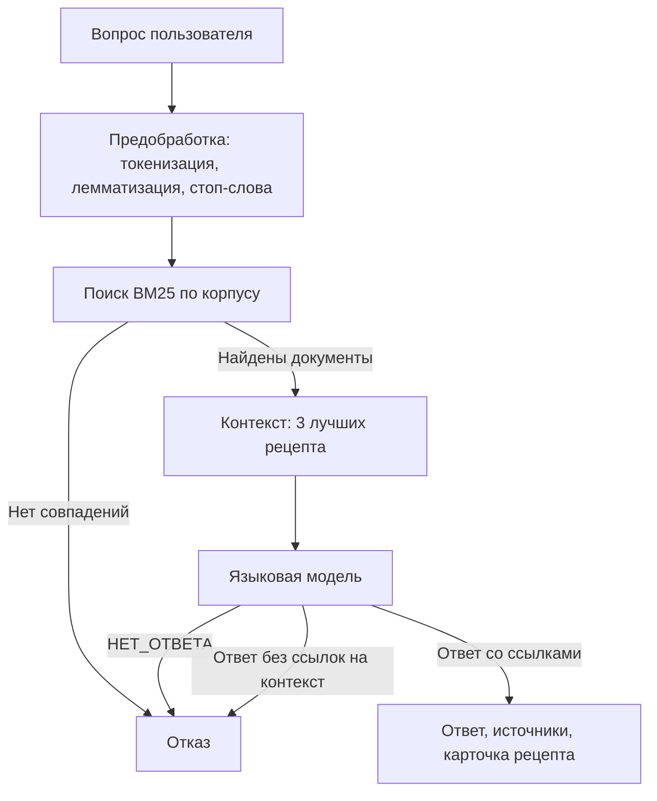

# Поиск и генерация ответов (RAG)

## 1. Общая схема

Ответ на вопрос пользователя строится в два этапа. Сначала BM25 находит в корпусе рецепты, наиболее подходящие к вопросу. Затем три лучших рецепта передаются языковой модели вместе с вопросом, и модель составляет ответ только по ним.



Результат передаётся backend в виде словаря:

```json
{
  "answer": "Текст ответа со ссылками [D01]",
  "sources": ["D01", "D02"],
  "recipe": {"title": "...", "cooking_time_minutes": 40, "ingredients": ["..."]}
}
```

## 2. Корпус

Корпус состоит из 30 рецептов (`D01`–`D30`) с сайтов food.ru, RussianFood.com и журнала «ЩИ» ВкусВилла. Для каждого рецепта сохранены:

- название;
- ингредиенты с количествами;
- шаги приготовления;
- общее время приготовления;
- источник: сайт, автор, ссылка, дата получения.

Названия, ингредиенты и время взяты из источников без изменений. Шаги пересказаны, так как тексты сайтов защищены авторским правом.

КБЖУ в корпус не включены: на сайтах они указаны на 100 г, а карточка рецепта в интерфейсе показывает значения на порцию.

Рецепты подобраны группами по три на каждый из 10 тестовых вопросов: блюда из курицы и грибов, из яиц, супы со свёклой и капустой, блюда из творога, из фарша, из картофеля, из рыбы, овощные салаты, блюда из гречки и десерты из яблок. Многие продукты встречаются в нескольких группах: яйца, картофель, грибы, курица, капуста. Поэтому соседние рецепты конкурируют в выдаче так же, как в реальной коллекции.

## 3. Предобработка текста

Документы и запросы обрабатываются одинаково.

1. **Нижний регистр и замена «ё» на «е».** Иначе «Свёкла» и «свекла» считались бы разными словами.
2. **Токенизация.** Токеном считается последовательность букв и цифр, знаки препинания отбрасываются. Слова через дефис («по-деревенски») делятся на части.
3. **Удаление чисел и однобуквенных токенов.** Количества («200 г», «2 ст. л.») не помогают найти рецепт, но увеличивают длину документа.
4. **Лемматизация.** Каждое слово приводится к начальной форме с помощью библиотеки pymorphy3.
5. **Удаление стоп-слов.** Удаляются служебные слова русского языка и слова, которые есть почти в каждом запросе к сервису: «приготовить», «рецепт», «блюдо», «посоветуйте».

### Почему лемматизация

В русском языке одно и то же слово встречается в разных формах. В вопросе пишут «из курицы и грибов», в рецепте — «куриное филе», «курицу нарежьте», «добавьте грибы». Без лемматизации совпадения по формам «курицы» и «курицу» не было бы, и поиск зависел бы от того, в каком падеже пользователь задал вопрос.

Лемматизация выбрана вместо стемминга, потому что pymorphy3 использует словарь и возвращает настоящую начальную форму слова. Стеммер отрезает окончания по правилам и иногда объединяет разные слова или разделяет формы одного. Собственный стеммер Snowball оставлен как запасной вариант на случай, если pymorphy3 не установлен.

Пример:

| Запрос | Термы после предобработки |
| --- | --- |
| Что приготовить из курицы и грибов? | `курица`, `гриб` |
| Что быстро приготовить на завтрак, если есть яйца? | `быстро`, `завтрак`, `яйцо` |
| Сколько калорий в одной порции борща? | `сколько`, `калория`, `один`, `порция`, `борщ` |

## 4. Индекс и ранжирование

Индекс хранит для каждого терма список документов, в которых он встречается, и число вхождений в каждом из них. Кроме того, сохраняются длина каждого документа в термах, средняя длина документа и число документов с каждым термом. Индексируются название рецепта, названия ингредиентов и шаги.

Релевантность документа $d$ запросу $q$ вычисляется по формуле BM25:

$$
IDF(t) = \ln\left(1 + \frac{N - DF(t) + 0.5}{DF(t) + 0.5}\right)
$$

$$
BM25(q, d) = \sum_{t \in q} IDF(t) \cdot \frac{TF(t, d)\,(k_1 + 1)}{TF(t, d) + k_1\left(1 - b + b\,\frac{|d|}{avgdl}\right)}
$$

Параметры: $k_1 = 1.2$, $b = 0.75$. Повторяющиеся слова запроса учитываются один раз. Документы сортируются по убыванию оценки, при равных оценках — по ID. Документы с нулевой оценкой в выдачу не попадают.

## 5. Генерация ответа

Модели передаются три документа с наибольшей оценкой. Каждый документ в контексте помечен своим ID и содержит название, время приготовления, ингредиенты и шаги.

Инструкция для модели требует:

- называть подходящие блюда их названиями из контекста;
- после каждого факта указывать ID документа, например `[D07]`;
- не добавлять ингредиенты, время, калорийность и шаги, которых нет в документах;
- проверять условия из вопроса («без мяса», «на завтрак») по ингредиентам;
- отвечать словом `НЕТ_ОТВЕТА`, если ни один рецепт не подходит или в документах нет нужных сведений.

Ответ модели проверяется программно:

- ссылки на документы, которых не было в контексте, отбрасываются;
- ответ без ссылок на контекст считается необоснованным и заменяется отказом;
- отказ всегда возвращается фиксированным текстом с пустым списком источников.

Карточка рецепта строится из первого документа в списке источников. Данные для карточки берутся только из корпуса.

Генерация выполняется моделью `qwen2.5:7b` через Ollama с температурой 0 и фиксированным зерном. Это делает результаты повторных прогонов сопоставимыми.

## 6. Ограничения

- **Синонимы.** BM25 сравнивает слова, а не смысл. «Яичница» и «яйцо», «картошка» и «картофель» для него разные термы. Из-за этого в вопросе про завтрак из яиц рецепты омлета и шакшуки оказываются ниже рецептов, где слово «яйца» встречается чаще.
- **Отрицания.** Запрос «без мяса» ищет документы со словом «мясо». Учесть такое условие может только модель на этапе генерации.
- **Ошибки лемматизации.** pymorphy3 приводит «суши» к глаголу «сушить». На этот запрос в корпусе всё равно нет ответа, но в общем случае такие ошибки снижают качество поиска.
- **Только текущий вопрос.** История чата в поиск и генерацию не передаётся.
- **Скорость.** Без видеокарты ответ модели занимает 1–2 минуты.
